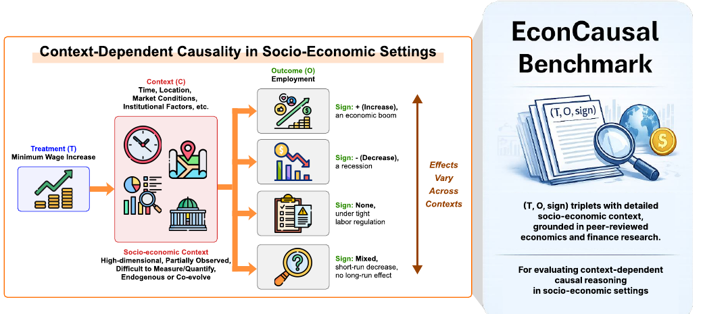

<h1 align="center">EconCausal: A Context-Aware Economic Reasoning Benchmark for Large Language Models</h1>

<p align="center">
  <b>Anonymous Authors</b>
</p>

<p align="center">
  <a href="#license"></a>
</p>

---

## Overview

Socio-economic causal effects depend heavily on their specific institutional and environmental context. A single intervention can produce opposite results depending on regulatory or market factors. This poses a significant challenge for LLMs in decision-support roles: **can they distinguish structural causal mechanisms from surface-level correlations when the context changes?**

**EconCausal** is a large-scale benchmark comprising **10,490 context-annotated causal triplets** extracted from **2,595 high-quality empirical studies** published in top-tier economics and finance journals. Through a rigorous four-stage pipeline combining multi-run consensus, context refinement, and multi-critic filtering, each claim is grounded in peer-reviewed research with explicit identification strategies.

<p align="center">
  
</p>

### Key Findings

- Top models achieve **~84% accuracy** in fixed, explicit contexts (Task 1).
- Across 19 models, Task 2 accuracy is **74.75% overall** and **44.27% on sign-mismatch pairs**, a **30.48 percentage-point gap** between these evaluation sets.
- With deliberately corrupted reference signs (Task 3), average accuracy is **58.66%**.
- Across the four task rows (Task 1 Economics, Task 1 Finance, Task 2, and Task 3), models achieve only **19.16% accuracy on `None`** and **35.22% on `mixed`**.

---

## Dataset

### Data Statistics

| Statistic | Value |
|---|---|
| Total causal triplets | 10,490 |
| Source papers | 2,595 |
| Publication years | 1991 -- 2025 |
| Economics journals | 5 (AER, QJE, JPE, ReStud, ECMA) |
| Finance journals | 3 (JFE, JF, RFS) |
| Domain split | Economics 67.7% / Finance 32.3% |

### Data Format

Each causal triplet includes:

| Field | Description |
|---|---|
| `treatment` | Independent variable / intervention |
| `outcome` | Dependent variable / affected endpoint |
| `sign` | Direction of causal effect (`+`, `-`, `None`, `mixed`) |
| `context` | Institutional and environmental context (max 100 words) |
| `identification_methods` | Identification strategies (DiD, IV, RCT, RDD, etc.) |
| Paper metadata | `paper_id`, `title`, `author`, `publication_year`, `published_venue`, `jel_codes`, `paper_url` |

---

## Benchmark Tasks

EconCausal includes three progressively challenging evaluation tasks probing context-dependent causal reasoning.

### Task 1: Causal Sign Prediction (947 econ + 860 finance)

Given a context and a treatment-outcome pair, predict the causal sign. Tests whether LLMs can internalize economic causalities from peer-reviewed research.

### Task 2: Context-Dependent Sign Prediction (415 reference–target pairs)

Given one correctly signed reference example under context c1, predict the study-reported sign for a comparable treatment–outcome pair under target context c2. Each released instance contains exactly one reference example and the exact question used in the main evaluation. The 415 pairs cover **273 unique target triplets from 178 target papers**; **124 pairs** have different source and target signs. Sign-mismatch is a subset of Task 2, not a separate task.

Pairs are drawn from papers that share a JEL code and have a direct citation link. Treatment and outcome phrases are embedded separately with `text-embedding-3-small`; the smaller of their cosine similarities is the matching score. The top 10% of 67,128 candidate pairs (6,712 pairs; threshold approximately 0.36) undergo a five-question comparability assessment by GPT-5.6 Luna. Retained pairs score at least 2 out of 3 on treatment comparability (Q2), outcome comparability (Q4), and causal-relation similarity (Q5); neither treatment nor outcome containment may be `DISTINCT` under Q1/Q3. The release excludes the two pairs that failed this final containment check.

### Task 3: Misinformation-Robust Sign Prediction (1,245 instances)

For each Task 2 pair, replace the reference's original sign with each of the **three other labels** in `+`, `-`, `None`, and `mixed`. This produces exactly three variants per pair while preserving the target context, treatment, outcome, and gold sign. A corrupted reference sign may coincide with the target's gold sign; corruption is defined relative to the reference's original sign. Each question uses the same prompt template as Task 2, without telling the model that the reference is corrupted.

The current release matches the 19-model main evaluation. Accuracy and Macro F1 retain invalid or missing predictions in the denominator; Macro F1 uses all four labels and assigns zero to undefined class F1. Published group and overall averages equally weight models.

---

## Repository Structure

```
econcausal-benchmark/
├── data/
│   ├── causal_triplets/        # 10,490 causal triplets (csv + jsonl)
│   ├── tasks/                  # Benchmark tasks (csv + jsonl)
│   │   ├── task1_econ.*        # Task 1 - Economics
│   │   ├── task1_finance.*     # Task 1 - Finance
│   │   ├── task2.*             # Task 2
│   │   ├── task3.*             # Task 3
│   │   └── task23_manifest.json # Counts, selection rules, and SHA-256 hashes
│   └── metadata/               # NBER paper metadata
├── prompts/
│   ├── evaluation/             # Benchmark task prompts (Tasks 1-3)
│   └── pipeline/               # Dataset-construction prompt templates
├── figures/
├── LICENSE
└── README.md
```

---

## Using the Dataset

The benchmark is released as static CSV and JSONL files under `data/`. The exact prompt presented for each benchmark instance is stored in its `question` field, and the expected label is stored in `answer`. Task 2 and Task 3 use exactly one reference example per instance, as in the main evaluation. CSV stores nested objects and lists as JSON strings; JSONL preserves their native structure. The label `None` is a literal string, not a missing value.

Use `question` as the model input. Keep `answer`, `expected_sign`, source-paper metadata, and Task 3's `original_sign` outside the model message. `case_id` and `pair_id` identify the frozen pairs, and Task 3's `source_task2_case_id` links each variant to its Task 2 question. Original signs are released for auditing the corruption rule only.

The current Task 2/3 benchmark is defined by these frozen files and their manifest. This repository contains dataset artifacts and prompt templates; API-specific evaluation runners are not included.

---

## License

This dataset is released under the [Creative Commons Attribution-NonCommercial 4.0 International License (CC BY-NC 4.0)](https://creativecommons.org/licenses/by-nc/4.0/).

- The causal triplets and benchmark tasks are derived from peer-reviewed academic papers.
- The source papers are the intellectual property of their respective authors and publishers.
- This dataset is intended for **research purposes only**.

---

## Citation

Citation details will be added after the anonymous review period.

```bibtex
@misc{anonymous2026econcausal,
  title={EconCausal: A Context-Aware Economic Reasoning Benchmark for Large Language Models},
  author={Anonymous Authors},
  year={2026},
  note={Anonymous submission}
}
```

---

## Contact

For questions during review, please use the anonymous review channel.
